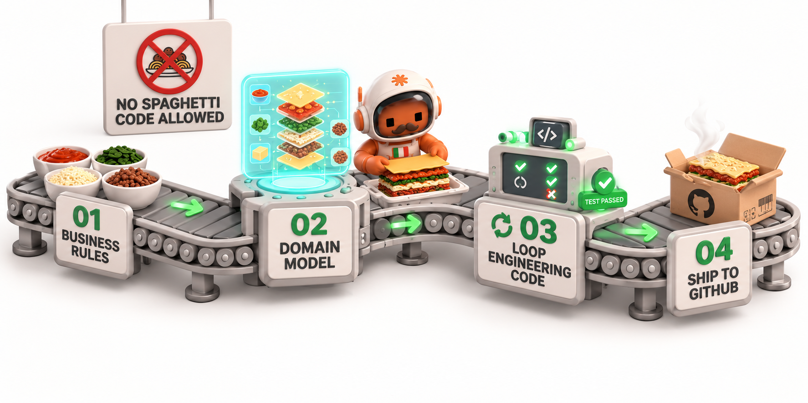

# 🍝 lasagna



**Un protocollo per descrivere processi di lavoro per i coding agent, e la CLI che li gestisce.**

[🇬🇧 English](README.md) | [🇮🇹 Italiano](README.it.md)

*L'opposto dello spaghetti code.* Scrivi il processo una volta, in file che qualunque coding agent può leggere, poi seguilo passo dopo passo, con i gate dove il lavoro si ferma per un controllo o una decisione umana.

[](LICENSE)
[](#-stato-pre-alpha)
[](pyproject.toml)

> **Nessuna relazione con il pacchetto [`lasagna-ai`](https://pypi.org/search/?q=lasagna-ai) su PyPI**, che è un progetto diverso. Questo repository è lasagna 3, un prodotto nuovo. È nato come [lasagna-code](https://github.com/TommasoTerrin/lasagna-code), un plugin legato a un solo agente di coding, ora deprecato perché lasagna 3 è un prodotto diverso: un protocollo indipendente dall'agente più una CLI Python, in un repository nuovo.

---

## 🎯 Che cos'è lasagna?

lasagna è un **protocollo** per descrivere processi di lavoro, più una **CLI Python** che li gestisce.

- Una **pipeline** è un grafo YAML di **nodi** (fasi) e **archi** (transizioni).
- I **gate** sono i punti in cui il lavoro si ferma: una decisione `human`, un comando `check` che deve uscire con 0, oppure una verifica `agent` di criteri elencati.
- Le **risorse** sono puntatori tipizzati (`path`, `doc`, `skill`, `subagent`, `mcp`, `cli`, `url`) che ogni fase usa, così l'agente sa di cosa ha bisogno e dove sta.
- `rules.md` spiega il protocollo a qualunque agente. Non c'è nulla da installare nell'agente.

lasagna non lancia agenti. **L'esecutore è sempre l'agente (o l'umano).** La CLI valida, disegna, copia e controlla le pipeline. Non avvia mai nessun agente di coding.

### Principi

- **Prima il processo.** Il processo è il prodotto: l'agente lo segue e non ne inventa uno.
- **Spec prima del codice.** Un umano approva la spec prima che si scriva codice.
- **Contratto congelato.** Firme, tipi ed errori si concordano prima di test e codice.
- **Rosso prima del verde.** Un test nuovo si scrive e si vede fallire, per la ragione giusta, prima del codice.
- **Fette verticali.** Ogni fetta attraversa tutti i livelli che servono; la prima è un tracer bullet.
- **I gate non si aggirano.** Un gate fallito blocca; l'agente non lo salta né lo approva da sé.
- **Il silenzio non è approvazione.** Solo una risposta esplicita dell'umano supera un gate umano.
- **Lo stato vive negli artefatti.** Ticket, file current e changelog tengono il progresso, non la memoria dell'agente.

## 🚧 Stato: pre-alpha

Dico onestamente a che punto siamo:

- **Esiste oggi:** il protocollo (spec 3.0.0, approvata il 2026-11-05), `rules.md` e le tre pipeline incluse (`project-manager`, `implementation`, `quick-fix`).
- **Non esiste ancora:** la CLI. Si sta costruendo *con le sue stesse pipeline* (dogfooding): il progetto è sviluppato con `project-manager` e `implementation`.
- **Non è pubblicato:** non c'è ancora nulla su PyPI. Non esiste un rilascio.
- Il protocollo funziona anche senza CLI: un agente che legge `.lasagna/` e `rules.md` può seguire una pipeline già oggi.

### Quattro numeri di versione

Cambiano indipendentemente, quindi è facile confonderli:

| Numero | Dove sta | Valore oggi |
|---|---|---|
| Protocollo | `lasagna: "3.0"` nei file YAML | `3.0` |
| Regole | prima riga di `rules.md` | `3.0.0` |
| CLI | il pacchetto `lasagna-cli` | `3.0.0.dev0` (in sviluppo) |
| Pipeline | `version:` in ogni `pipeline.yaml` | `1.0.0` per ogni pipeline inclusa |

---

## 🍝 Perché lasagna e non spaghetti?

| Problema | Spaghetti | lasagna |
|---|---|---|
| **Il processo vive nella testa di qualcuno** | 🔴 Ogni sessione riparte dalla memoria e da ciò che ha ricordato l'ultimo agente | 🟢 Lo stato vive negli artefatti: ticket, file `current`, changelog. Ogni sessione li rilegge |
| **Nessuno ha approvato la spec** | 🔴 Si scrive il codice prima e la spec si ricostruisce dopo | 🟢 Un gate umano prima dello slicing e prima di ogni codice |
| **Il test è modellato dal codice** | 🔴 I test fotografano l'implementazione | 🟢 Test-writer e implementer sono tenuti separati dalla pipeline, per convenzione (vedi sotto) |
| **Integrazione big-bang** | 🔴 Logica testata contro un backend immaginario | 🟢 Fette verticali, con un tracer bullet per primo |
| **Nessuno sa dove fermarsi** | 🔴 Budget sforati e ritentativi silenziosi | 🟢 Gate che bloccano, e un budget di ritentativi su ogni loop (`max_iterations`) |
| **Il processo si copia a mano** | 🔴 Una pagina wiki che si allontana da ciò che la gente fa davvero | 🟢 Una pipeline è una cartella: si può validare, disegnare e confrontare due versioni con un diff |

---

## 🔍 Come funziona

### Pipeline, nodi, archi

Una pipeline è una cartella con un `pipeline.yaml` e, se servono, una cartella `assets/` con template e prompt per i subagent. Ogni nodo ha una `description`, `steps` opzionali (istruzioni, in ordine), `resources` opzionali e un `gate` opzionale. Gli archi collegano i nodi:

- `direct`: va al nodo successivo quando quello corrente passa;
- `loop`: torna indietro (spesso su sé stesso) quando la condizione è vera, al più `max_iterations` volte;
- `router`: sceglie una tra più strade, decisa dall'agente, dall'umano o da un comando `check`.

Ogni nodo chiude con `pass` o `fail`. Il gate, se c'è, decide l'esito. Un nodo senza gate passa sempre. Un gate fallito senza un arco che lo gestisca **blocca** la pipeline: l'agente si ferma, riporta la causa e chiede all'umano.

### Un frammento vero

Dalla pipeline `implementation` (accorciato: `...` segna un taglio; le altre righe sono testuali):

```yaml
  - id: green
    name: "Green"
    description: >
      The implementer writes the minimum production code that makes the new
      test pass without breaking the others.
    steps:
      - "Delegate to the implementer subagent with: the contract, the test name, ..."
    resources:
      - { type: subagent, ref: "$pipeline/assets/implementer.md" }
      - { type: path, ref: "{{ params.source_dir }}", access: write }
    gate:
      type: check
      run: "{{ params.test_command }}"

edges:
  - { type: direct, from: contract, to: red }
  - { type: loop, from: red, to: red, when: fail, max_iterations: 3 }
  - { type: direct, from: red, to: green }
  - { type: loop, from: green, to: green, when: fail, max_iterations: 3 }
  - type: loop
    from: green
    to: red
    when: "Tests to pass has an unchecked line for a criterion verified by a test."
    max_iterations: 30
```

`{{ params.test_command }}` viene sostituito quando la pipeline viene letta; i soli segnaposto sono `params` e `inputs`, e solo nei campi di testo.

### Gate

| Gate | Passa quando | Esempio |
|---|---|---|
| `human` | un umano approva esplicitamente. Il silenzio non è mai approvazione | "Approve the spec of v{{ inputs.version }}" |
| `check` | il comando `run` esce con 0 | `run: "{{ params.test_command }}"` |
| `agent` | ogni criterio elencato è soddisfatto, giudicato con una motivazione (da un subagent separato con `by: subagent`) | "Every criterion of the ticket has at least one planned verification." |

---

## 📦 Pipeline incluse

Il pacchetto include tre pipeline. Sono istruzioni in chiaro per l'agente; i diagrammi qui sotto sono disegnati dai loro file YAML.

Legenda: `[H]` gate umano, `[C]` gate check, `[A]` gate agent. `↺` è un loop verso un nodo.

### `project-manager`: pianifica e chiude una versione

Si rientra ad ogni sessione di pianificazione: `intake` legge gli artefatti, non la memoria.

```text
intake (router, decide l'agente)
 ├─ nessuna spec approvata ─────────────▶ grilling
 ├─ spec approvata, senza indice ───────▶ slicing
 ├─ ticket approvati, non tutti fatti ──▶ dispatch
 └─ ogni ticket fatto ──────────────────▶ close_version

grilling ──▶ spec [H] ──▶ slicing [H] ──▶ dispatch ──▶ (fine: next_ticket)

ritentativi: spec ↺ grilling (fail, max 3)   slicing ↺ slicing (fail, max 3)

close_version [C, at entry] ──▶ release [H, at entry] ──▶ (fine)
```

### `implementation`: un ticket, una sessione

Prima il contratto, poi TDD rosso e verde una verifica pianificata alla volta, con due subagent isolati, una revisione avversaria e una chiusura umana.

```text
contract [A] ──▶ red [A] ──▶ green [C] ──▶ review [A] ──▶ close [H, at entry]

ritentativi:    red ↺ red (fail, max 3)     green ↺ green (fail, max 3)
ritorno a red:  green ↺ red (un test non spuntato in "Tests to pass", max 30)
                review ↺ red (fail, max 2)
```

`max_iterations: 3` consente 3 ritentativi. Il conteggio si azzera quando il nodo passa, quindi il budget vale per ogni test pianificato (spec §6.3).

Il subagent test-writer non legge mai il codice di produzione oltre le firme del contratto. Il subagent implementer non legge né scrive mai i file di test. Entrambe le regole sono convenzioni che l'agente deve rispettare, non sono imposte da un hook (vedi la sezione successiva).

### `quick-fix`: una modifica piccola o un bug

Per modifiche che toccano al massimo due file e non aggiungono modulo, comando, simbolo pubblico o dipendenza. Il lavoro più grande torna a `project-manager`.

```text
understand [A] ──▶ fix [C] ──▶ close [H, at entry]

ritentativi: fix ↺ fix (fail, max 3)
```

---

## 🧭 Che cosa è convenzione e che cosa no

lasagna 3.0 è volutamente onesta sulle sue garanzie.

| Meccanismo | Stato in 3.0 | Chi lo fa valere |
|---|---|---|
| Gate `check` | **Deterministico**: il comando esce con 0 oppure no | La shell |
| Gate `human` | L'agente deve fermarsi e aspettare; il silenzio non è approvazione | L'agente (convenzione) |
| Gate `agent` | Un giudizio con una motivazione scritta | L'agente (convenzione) |
| `access` sulle risorse (`read`, `write`) | Convenzione: l'agente scrive solo dove è dichiarato `write` | L'agente (convenzione) |
| Isolamento dei subagent (test-writer ≠ implementer) | Convenzione, scritta nella pipeline e nei prompt | L'agente (convenzione) |
| `agent_can_edit_pipelines: false` | Convenzione: l'agente non modifica `.lasagna/` | L'agente (convenzione) |
| Hook, sandbox, permessi | Non in 3.0 | Adapter, previsti per la 3.1 |

**Il vantaggio di lasagna non è l'affidabilità.** Senza adapter dipende dall'agente che segue le istruzioni, come qualunque prompt. I suoi vantaggi sono la **portabilità** (lo stesso processo per qualunque agente), la **componibilità** (le pipeline si copiano, si parametrizzano e si riusano pezzo per pezzo) e la **standardizzazione** (una pipeline si può validare, disegnare e confrontare con un diff, mentre una skill è un blocco di testo).

---

## 🛠️ Installa e prova oggi

### Installazione (prevista, non ancora disponibile)

Una volta pubblicata, la CLI si installerà con `uv tool install lasagna-cli` (oppure `pipx install lasagna-cli`, o si lancia con `uvx`). **Non è ancora su PyPI**, e i comandi qui sotto non funzionano ancora.

| Comando | Che cosa farà |
|---|---|
| `lasagna init` | crea `.lasagna/`, scrive il blocco in `AGENTS.md`, aggiunge facoltativamente pipeline incluse |
| `lasagna validate` | controlla registry e pipeline con le regole V01–V25 |
| `lasagna list` | elenca le pipeline abilitate (`--builtin` per quelle del pacchetto) |
| `lasagna show <id>` | mostra una pipeline, o un nodo, già renderizzata per l'agente |
| `lasagna graph <id>` | disegna una pipeline come diagramma Mermaid |
| `lasagna check <id> <node>` | esegue il gate `check` di un nodo |
| `lasagna doctor` | verifica che le risorse di una pipeline esistano |
| `lasagna add <source>` | copia una pipeline inclusa (`builtin:<id>`) o una cartella locale nel progetto |

### Provare il protocollo oggi, senza CLI

1. Copia la cartella `.lasagna/` di questo repository nel tuo progetto.
2. Copia la sezione `## Process (lasagna)` dell'`AGENTS.md` di questo repository nell'`AGENTS.md` del tuo progetto.
3. Avvia una sessione e chiedi all'agente di leggere `.lasagna/rules.md` e di scegliere una pipeline da `.lasagna/pipelines.yaml`.

Prima di affidarti a questo, adatta i `params` di `pipelines.yaml` al tuo progetto (il comando di test, i nomi delle cartelle). I campi `source` puntano alla cartella `src/` di questo repository e sono solo informativi. Una pipeline è un insieme di istruzioni per il tuo agente, e i suoi gate `check` sono comandi eseguiti nella tua shell: leggili prima.

---

## 🗺️ Roadmap

| Versione | Tema | Stato |
|---|---|---|
| **3.0.0** | Protocollo 3.0, CLI di base, pipeline incluse, dogfooding | in corso |
| **3.1.0** | Adapter (Claude Code per primo) e suite di conformità | prevista |
| **3.2.0** | Stato, resume, cicli `foreach` e sottopipeline | prevista |
| **3.3.0** | Trigger e automazione | prevista |
| **3.4.0** | Distribuzione: libreria globale (`save`, `add library:`, `add git+`), indice della community, lockfile, aggiornamenti | prevista |
| **4.0.0** | Team e governance: permessi, approvazioni reali, telemetria, valutazione | prevista |

Il piano completo, con le domande aperte per ogni versione, è in [`docs/roadmap.md`](docs/roadmap.md).

---

## 📁 Struttura del repository

```text
lasagna-cli/
├── AGENTS.md              # ingresso per i coding agent e per le persone   (esiste)
├── .lasagna/              # processo di questo repository (copia congelata)  (esiste)
│   ├── rules.md
│   ├── pipelines.yaml
│   └── pipelines/
├── src/lasagna/
│   ├── protocol/rules.md  # regole del protocollo incluse nel pacchetto      (esiste)
│   ├── builtin/           # le tre pipeline incluse e i loro asset           (esiste)
│   ├── core/              # logica pura: niente I/O                          (previsto)
│   ├── shell/             # file system, comandi, PATH                       (previsto)
│   └── cli.py             # typer: solo parsing e chiamate                   (previsto)
├── tests/                 # suite di test (scaffold)                         (esiste)
├── docs/                  # documenti di progetto, in italiano               (esiste)
└── pyproject.toml, uv.lock, REUSE.toml, LICENSE, LICENSES/, NOTICE          (esiste)
```

I documenti di progetto in `docs/` sono in italiano. Codice, `rules.md`, pipeline, messaggi della CLI e questo README sono in inglese.

---

## 🔗 Rapporto con lasagna-code e lasagna-ai

- **[lasagna-code](https://github.com/TommasoTerrin/lasagna-code)** è il plugin della versione 2, legato a un solo agente di coding. È **deprecato** e non più sviluppato. Non esiste un percorso di migrazione. Le sue idee migliori (un gate sulla spec, un contratto congelato, test-writer e implementer isolati, un budget di ritentativi per criterio, la revisione avversaria) sono nelle pipeline incluse di lasagna 3. La sua specifica resta come riferimento in [`docs/reference/lasagna-v2-spec.md`](docs/reference/lasagna-v2-spec.md).
- **`lasagna-ai`** su PyPI è un progetto non correlato. Non confondere i due.

---

## 📄 Licenza

lasagna è sotto licenza per percorso, in modo che copiare una pipeline nel proprio progetto non richieda attribuzione:

| Contenuto | Licenza | Testo completo |
|---|---|---|
| Codice, specifica, documentazione, test | **Apache-2.0** | [`LICENSE`](LICENSE), [`LICENSES/Apache-2.0.txt`](LICENSES/Apache-2.0.txt) |
| Pipeline incluse e asset (`src/lasagna/builtin/`), `rules.md` (`src/lasagna/protocol/rules.md`) e le loro copie in `.lasagna/` | **MIT-0** | [`LICENSES/MIT-0.txt`](LICENSES/MIT-0.txt) |

La mappatura è in [`REUSE.toml`](REUSE.toml), e il riepilogo è in [`NOTICE`](NOTICE). MIT-0 non richiede attribuzione, quindi i contenuti che `lasagna init` e `lasagna add` copiano in altri progetti non portano note di copyright.
---

## 🤝 Contribuire e sicurezza

- Leggi [CONTRIBUTING.md](CONTRIBUTING.md) prima di aprire una pull request. Il progetto è costruito con le sue pipeline, e le decisioni della sezione 3 della specifica sono chiuse.
- Per segnalare una vulnerabilità, segui [SECURITY.md](SECURITY.md). Non aprire una issue pubblica.
- I documenti di progetto in `docs/` sono in italiano: [specifica della 3.0.0](docs/specs/v3.0.0.md), [roadmap](docs/roadmap.md), [architettura e convenzioni](docs/architecture.md), [revisione dell'harness M0](docs/reviews/2026-11-05-m0-review.md).

---

## 👤 Autore

**Tommaso Terrin**

- GitHub: [@TommasoTerrin](https://github.com/TommasoTerrin)
- LinkedIn: [Tommaso Terrin](https://www.linkedin.com/in/tommaso-terrin-750472253/)
