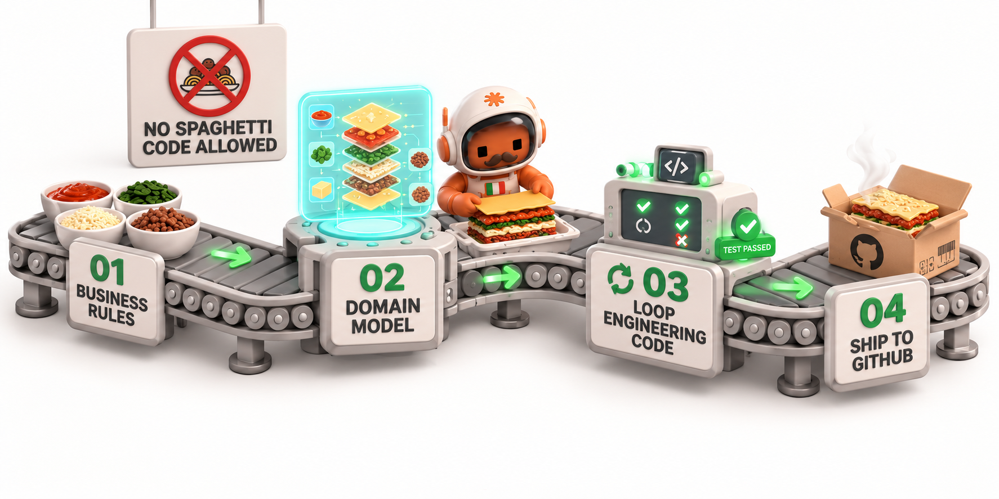

# 🍝 lasagna



**A protocol to describe work processes for coding agents, and the CLI that manages it.**

[🇬🇧 English](README.md) | [🇮🇹 Italiano](README.it.md)

*The opposite of spaghetti code.* Write the process once, in files any coding agent can read, then follow it step by step, with gates where the work stops for a check or a human decision.

[](LICENSE)
[](#-status-pre-alpha)
[](pyproject.toml)

> **Not related to the [`lasagna-ai`](https://pypi.org/search/?q=lasagna-ai) package on PyPI**, which is a different project. This repository is lasagna 3, a new product. Its predecessor is [lasagna-code](https://github.com/TommasoTerrin/lasagna-code), a Claude Code plugin, now deprecated.

---

## 🎯 What is lasagna?

lasagna is a **protocol** for describing work processes, plus a **Python CLI** that manages them.

- A **pipeline** is a YAML graph of **nodes** (phases) and **edges** (transitions).
- **Gates** are the points where the work stops: a `human` decision, a `check` command that must exit 0, or an `agent` review of listed criteria.
- **Resources** are typed pointers (`path`, `doc`, `skill`, `subagent`, `mcp`, `cli`, `url`) that each phase uses, so the agent knows what it needs and where it lives.
- `rules.md` explains the protocol to any agent. There is nothing to install in the agent.

lasagna does not run agents. **The executor is always the agent (or the human).** The CLI validates, draws, copies and checks pipelines. It never launches Claude Code, Codex, opencode or anything else.

### Principles

- **Process first.** The process is the product: the agent follows it and does not improvise one.
- **Spec before code.** A human approves the spec before any code is written.
- **Frozen contract.** Signatures, types and errors are agreed before tests and code.
- **Red before green.** A new test is written and seen failing, for the right reason, before the code.
- **Vertical slices.** Each slice cuts through every layer it needs; the first one is a tracer bullet.
- **Gates are not worked around.** A failed gate blocks; the agent does not skip it or approve it itself.
- **Silence is not approval.** Only an explicit answer from the human passes a human gate.
- **State lives in artifacts.** Tickets, the current file and the changelog hold the progress, not the agent's memory.

## 🚧 Status: pre-alpha

Being honest about where things stand:

- **Exists today:** the protocol (spec 3.0.0, approved on 2026-11-05), `rules.md`, and the three built-in pipelines (`project-manager`, `implementation`, `quick-fix`).
- **Does not exist yet:** the CLI. It is being built *with its own pipelines* (dogfooding): the project is developed by `project-manager` and `implementation`.
- **Not published:** nothing is on PyPI yet. There is no release.
- The protocol works without the CLI: an agent that reads `.lasagna/` and `rules.md` can follow a pipeline today.

### Four version numbers

They change independently, so they are easy to mix up:

| Number | Where it lives | Value today |
|---|---|---|
| Protocol | `lasagna: "3.0"` in the YAML files | `3.0` |
| Rules | first line of `rules.md` | `3.0.0` |
| CLI | the `lasagna-cli` package | `3.0.0.dev0` (in development) |
| Pipeline | `version:` in each `pipeline.yaml` | `1.0.0` for each built-in pipeline |

---

## 🍝 Why lasagna, not spaghetti?

| Problem | Spaghetti | lasagna |
|---|---|---|
| **The process lives in someone's head** | 🔴 Every session starts from memory and from whatever the last agent remembered | 🟢 State lives in artifacts: tickets, the `current` file, the changelog. Each session re-reads them |
| **Nobody approved the spec** | 🔴 The code is written first and the spec is reconstructed afterwards | 🟢 A human gate before slicing and before any code |
| **The test is shaped by the code** | 🔴 Tests photograph the implementation | 🟢 The test-writer and the implementer are kept apart by the pipeline, by convention (see below) |
| **Big-bang integration** | 🔴 Logic tested against an imagined backend | 🟢 Vertical slices, with a tracer bullet first |
| **Nobody knows where to stop** | 🔴 Budget overruns and silent retries | 🟢 Gates that block, and a retry budget on every loop (`max_iterations`) |
| **The process is copied by hand** | 🔴 A wiki page that drifts away from what people do | 🟢 A pipeline is a folder: you can validate it, draw it and compare two versions with a diff |

---

## 🔍 How it works

### Pipelines, nodes, edges

A pipeline is a folder with a `pipeline.yaml`, and optionally an `assets/` folder with templates and subagent prompts. Every node has a `description`, optional `steps` (instructions, in order), optional `resources`, and an optional `gate`. Edges connect the nodes:

- `direct`: go to the next node when the current one passes;
- `loop`: go back to a node (often itself) when the condition holds, at most `max_iterations` times;
- `router`: choose one of several routes, decided by the agent, by the human, or by a `check` command.

Every node ends with `pass` or `fail`. The gate, if any, decides the outcome. A node without a gate always passes. A failed gate with no edge that handles it **blocks** the pipeline: the agent stops, reports the cause and asks the human.

### A real fragment

From the `implementation` pipeline (abridged: `...` marks a cut; the other lines are verbatim):

```yaml
  - id: green
    name: "Green"
    description: >
      The implementer writes the minimum production code that makes the new
      test pass without breaking the others.
    steps:
      - "Delegate to the implementer subagent with: the contract, the test name, ..."
    resources:
      - { type: subagent, ref: "$pipeline/assets/implementer.md" }
      - { type: path, ref: "{{ params.source_dir }}", access: write }
    gate:
      type: check
      run: "{{ params.test_command }}"

edges:
  - { type: direct, from: contract, to: red }
  - { type: loop, from: red, to: red, when: fail, max_iterations: 3 }
  - { type: direct, from: red, to: green }
  - { type: loop, from: green, to: green, when: fail, max_iterations: 3 }
  - type: loop
    from: green
    to: red
    when: "Tests to pass has an unchecked line for a criterion verified by a test."
    max_iterations: 30
```

`{{ params.test_command }}` is replaced when the pipeline is read; the only placeholders are `params` and `inputs`, and only in text fields.

### Gates

| Gate | Passes when | Example |
|---|---|---|
| `human` | a human explicitly approves. Silence is never approval | "Approve the spec of v{{ inputs.version }}" |
| `check` | the `run` command exits 0 | `run: "{{ params.test_command }}"` |
| `agent` | every listed criterion is met, judged with a reason (by a separate subagent when `by: subagent`) | "Every criterion of the ticket has at least one planned verification." |

---

## 📦 Built-in pipelines

Three pipelines ship with the package. They are plain instructions for the agent; the diagrams below are drawn from their YAML files.

Legend: `[H]` human gate, `[C]` check gate, `[A]` agent gate. `↺` is a loop back to a node.

### `project-manager`: plan and close a version

Re-enter it at the start of every planning session: `intake` reads the artifacts, not memory.

```text
intake (router, decided by the agent)
 ├─ no approved spec ───────────────────▶ grilling
 ├─ spec approved, no tickets index ────▶ slicing
 ├─ tickets approved, not all done ─────▶ dispatch
 └─ every ticket done ──────────────────▶ close_version

grilling ──▶ spec [H] ──▶ slicing [H] ──▶ dispatch ──▶ (end: next_ticket)

retries: spec ↺ grilling (fail, max 3)   slicing ↺ slicing (fail, max 3)

close_version [C, at entry] ──▶ release [H, at entry] ──▶ (end)
```

### `implementation`: one ticket, one session

Contract first, then red and green TDD one planned test at a time, with two isolated subagents, an adversarial review and a human close.

```text
contract [A] ──▶ red [A] ──▶ green [C] ──▶ review [A] ──▶ close [H, at entry]

retries:     red ↺ red (fail, max 3)     green ↺ green (fail, max 3)
back to red: green ↺ red (an unchecked test in "Tests to pass", max 30)
             review ↺ red (fail, max 2)
```

`max_iterations: 3` allows 3 retries. The count resets when the node passes, so the budget applies to each planned test (spec §6.3).

The test-writer subagent never reads production code beyond the contract's signatures. The implementer subagent never reads or writes test files. Both rules are conventions the agent is asked to follow, not enforced by a hook (see the next section).

### `quick-fix`: a small change or a bug

For changes that touch at most two files and add no module, command, public symbol or dependency. Larger work is sent back to `project-manager`.

```text
understand [A] ──▶ fix [C] ──▶ close [H, at entry]

retries: fix ↺ fix (fail, max 3)
```

---

## 🧭 What is convention and what is not

lasagna 3.0 is deliberately honest about its guarantees.

| Mechanism | Status in 3.0 | Who makes it hold |
|---|---|---|
| `check` gates | **Deterministic**: the command exits 0 or it does not | The shell |
| `human` gates | The agent must stop and wait; silence is not approval | The agent (convention) |
| `agent` gates | A judgement with a written reason | The agent (convention) |
| `access` on resources (`read`, `write`) | Convention: the agent writes only where `write` is declared | The agent (convention) |
| Subagent isolation (test-writer ≠ implementer) | Convention, written into the pipeline and the prompts | The agent (convention) |
| `agent_can_edit_pipelines: false` | Convention: the agent does not edit `.lasagna/` | The agent (convention) |
| Hooks, sandbox, permissions | Not in 3.0 | Adapters, planned for 3.1 |

**The advantage of lasagna is not reliability.** Without adapters, it depends on the agent following the instructions, like any prompt. Its advantages are **portability** (the same process for any agent), **composability** (pipelines are copied, parametrised and reused piece by piece) and **standardisation** (a pipeline can be validated, drawn and compared with a diff, while a skill is a block of text).

---

## 🛠️ Install and try it today

### Installation (planned, not yet available)

Once published, the CLI will be installed with `uv tool install lasagna-cli` (or `pipx install lasagna-cli`, or run with `uvx`). **It is not on PyPI yet**, and the commands below do not work yet.

| Command | What it will do |
|---|---|
| `lasagna init` | create `.lasagna/`, write the `AGENTS.md` block, optionally add built-in pipelines |
| `lasagna validate` | check the registry and the pipelines against the rules V01–V25 |
| `lasagna list` | list the enabled pipelines (`--builtin` for the ones in the package) |
| `lasagna show <id>` | show a pipeline, or one node, rendered for the agent |
| `lasagna graph <id>` | draw a pipeline as a Mermaid diagram |
| `lasagna check <id> <node>` | run the `check` gate of a node |
| `lasagna doctor` | verify that the resources a pipeline needs exist |
| `lasagna add <source>` | copy a built-in pipeline (`builtin:<id>`) or a local folder into the project |

### Try the protocol today, without the CLI

1. Copy the `.lasagna/` folder of this repository into your project.
2. Copy the `## Process (lasagna)` section of this repository's `AGENTS.md` into your project's `AGENTS.md`.
3. Start a session and ask the agent to read `.lasagna/rules.md` and pick a pipeline from `.lasagna/pipelines.yaml`.

Before you rely on it, adjust the `params` in `pipelines.yaml` to your project (the test command, the folder names). The `source` fields point to this repository's `src/` and are informative only. A pipeline is instructions for your agent, and its `check` gates are commands run in your shell: read them first.

---

## 🗺️ Roadmap

| Version | Theme | Status |
|---|---|---|
| **3.0.0** | Protocol 3.0, basic CLI, built-in pipelines, dogfooding | in progress |
| **3.1.0** | Adapters (Claude Code first) and conformance suite | planned |
| **3.2.0** | State, resume, `foreach` loops and sub-pipelines | planned |
| **3.3.0** | Triggers and automation | planned |
| **3.4.0** | Distribution: global library (`save`, `add library:`, `add git+`), community index, lockfile, updates | planned |
| **4.0.0** | Teams and governance: permissions, real approvals, telemetry, evaluation | planned |

The full plan, with the open questions for each version, is in [`docs/roadmap.md`](docs/roadmap.md).

---

## 📁 Repository layout

```text
lasagna-cli/
├── AGENTS.md              # entry point for coding agents and people    (exists)
├── .lasagna/              # this repository's own process (frozen copy) (exists)
│   ├── rules.md
│   ├── pipelines.yaml
│   └── pipelines/
├── src/lasagna/
│   ├── protocol/rules.md  # protocol rules shipped with the package     (exists)
│   ├── builtin/           # the three built-in pipelines and assets     (exists)
│   ├── core/              # pure logic: no I/O                          (planned)
│   ├── shell/             # file system, commands, PATH                 (planned)
│   └── cli.py             # typer: parsing and calls only               (planned)
├── tests/                 # test suite (scaffold)                       (exists)
├── docs/                  # project documents, in Italian               (exists)
└── pyproject.toml, uv.lock, REUSE.toml, LICENSE, LICENSES/, NOTICE      (exists)
```

Project documents in `docs/` are written in Italian. Code, `rules.md`, pipelines, CLI messages and this README are in English.

---

## 🔗 Relationship to lasagna-code and lasagna-ai

- **[lasagna-code](https://github.com/TommasoTerrin/lasagna-code)** is the Claude Code plugin of version 2. It is **deprecated** and no longer developed. There is no migration path. Its best ideas (a spec gate, a frozen contract, isolated test-writer and implementer, a retry budget per criterion, adversarial review) are in the built-in pipelines of lasagna 3. Its specification is kept as background in [`docs/reference/lasagna-v2-spec.md`](docs/reference/lasagna-v2-spec.md).
- **`lasagna-ai`** on PyPI is an unrelated project. Do not confuse the two.

---

## 📄 License

lasagna is licensed by path, so that copying a pipeline into your project needs no attribution:

| Content | License | Full text |
|---|---|---|
| Code, specification, documentation, tests | **Apache-2.0** | [`LICENSE`](LICENSE), [`LICENSES/Apache-2.0.txt`](LICENSES/Apache-2.0.txt) |
| Built-in pipelines and assets (`src/lasagna/builtin/`), `rules.md` (`src/lasagna/protocol/rules.md`) and their copies in `.lasagna/` | **MIT-0** | [`LICENSES/MIT-0.txt`](LICENSES/MIT-0.txt) |

The mapping is in [`REUSE.toml`](REUSE.toml), and the summary is in [`NOTICE`](NOTICE). MIT-0 requires no attribution, so the content that `lasagna init` and `lasagna add` copy into other projects does not carry copyright notices.
---

## 🤝 Contributing and security

- Read [CONTRIBUTING.md](CONTRIBUTING.md) before opening a pull request. The project is built with its own pipelines, and the decisions in section 3 of the specification are closed.
- To report a vulnerability, follow [SECURITY.md](SECURITY.md). Do not open a public issue.
- The project documents in `docs/` are in Italian: [specification of 3.0.0](docs/specs/v3.0.0.md), [roadmap](docs/roadmap.md), [architecture and conventions](docs/architecture.md), [review of the M0 harness](docs/reviews/2026-11-05-m0-review.md).

---

## 👤 Author

**Tommaso Terrin**

- GitHub: [@TommasoTerrin](https://github.com/TommasoTerrin)
- LinkedIn: [Tommaso Terrin](https://www.linkedin.com/in/tommaso-terrin-750472253/)
